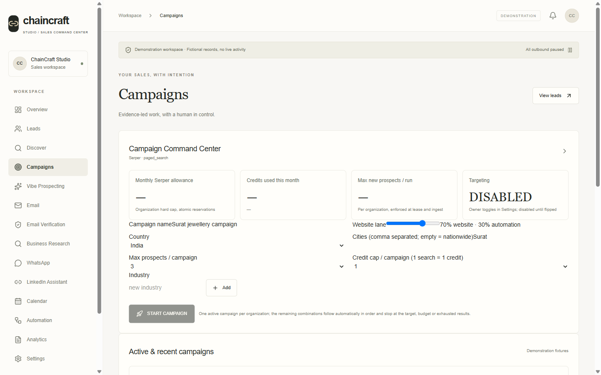
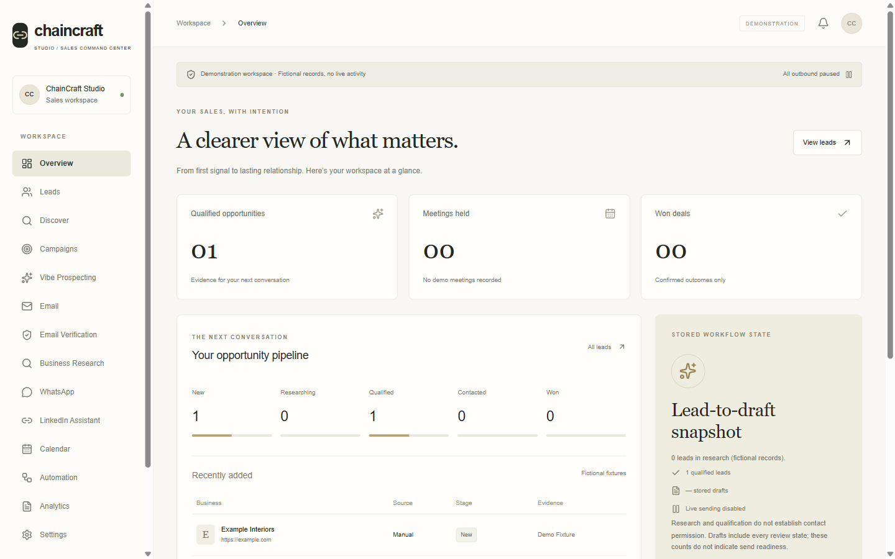
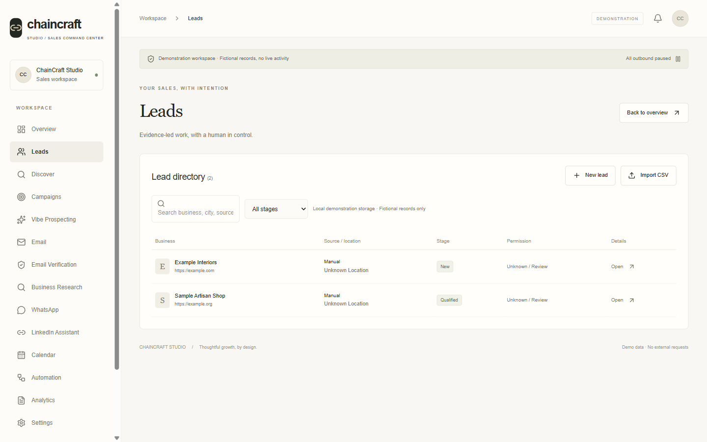
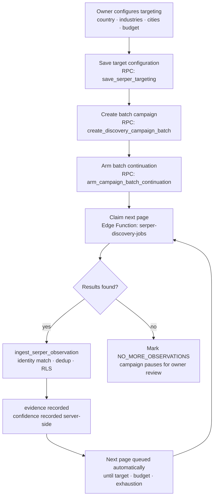
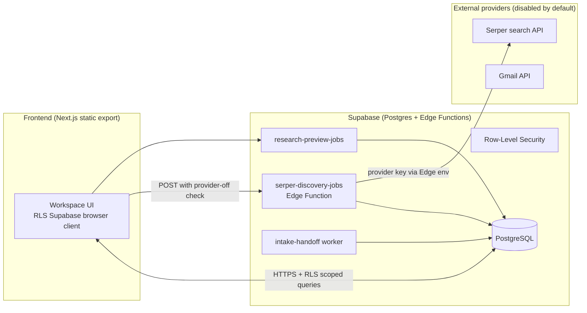

# Agency Growth Automation Platform

**AI-Powered Lead Discovery, Sales Automation & Agency Management System**

> An international lead-discovery, prospect-qualification, CRM, website research and campaign-orchestration platform. Built for multi-country, multi-industry B2B agencies. Node 24, React 19, Supabase (PostgreSQL + RLS + Edge Functions), TypeScript throughout.

<p align="center">
  
  
  
  
  
  
</p>







---

## Project status

> **IN ACTIVE DEVELOPMENT**
>
> Core systems are implemented and under integration, testing and production-readiness validation. **Full production deployment is planned following completion of the remaining integration and validation work.** Nothing in this repository claims to be production-deployed, live-verified, or custodied sends.

### Planned email capacity

> **PLANNED CAPACITY — up to 15,000 emails per month**
>
> This is the platform's engineering target and intended capacity, **not a verified production capability**. It is constrained by:
> - Connected email accounts and sender availability
> - Google/Gmail sending quotas and account restrictions
> - Sender reputation, deliverability and consent/suppression controls
> - Per-campaign and account-level sending limits
> - Successful production load and reliability testing (not yet performed)
>
> **No email provider is live. Live sending is disabled by default and gated behind explicit organization approval, verified sender accounts and consent controls.**

---

## The problem

B2B agencies lose weeks to manual prospecting: finding relevant businesses across countries and industries, verifying who actually exists, deciding who is worth contacting, and remembering to follow up without breaking provider rules or consents.

## What this platform does

An evidence-first sales workspace for international agencies:

- **Discover** businesses across countries, regions and industries via paid search providers, with directory filtering, business-identity checks and deduplication.
- **Qualify** prospects using evidence-cited scoring, with human review wherever the machine is uncertain.
- **Orchestrate** bounded discovery campaigns with credits, budgets, automatic continuation, pause/resume/cancel and complete diagnostics.
- **Prepare** website research and preview generation with strict evidence bindings and zero outbound leakage before approval.
- **Automate** follow-up workflows behind per-sender account caps and organization-level approvals.
- **Enforce** privacy, consent, suppression and organization isolation end-to-end.

---

## Key capabilities

### Lead discovery & campaign orchestration
- Multi-country, multi-city and multi-industry targeting (Surat, Mumbai, Pune, …; India, US, UK, AE, …)
- Serper-based search integration with paged-search ads breakdown (bounded 1-credit/page)
- Organization-scoped campaigns, one active per org, multi-combination batch creation
- Automatic page continuation with row-locked leases, expired-lease recovery, retry with backoff
- Anti-directory filtering (Instagram, Facebook, Booking, Yelp, IndiaMART, Justdial, PDF class) plus credibility/identity verification
- Evidence ingestion and manual-review queues for anything ambiguous or conflicting
- Per-page rejection diagnostics (raw/name/education/identity/snippet/unsafe-URL/duplicate/accept counts)
- Start/Pause/Resume/Cancel controls, all org-scoped and admin-gated

### Prospect intelligence
- Business identity verification and official website classification
- Third-party directory detection (IndiaMART, Justdial, TradeIndia, …)
- Duplicate prevention by normalized domain and business identity
- Independent-publisher evidence corroboration before claims are made
- Contact enrichment (audit-based, opt-in, never guessed)
- Lead qualification with evidence-threshold routing to human review

### Sales workflow
- CRM with evidence timelines, review labels and manual verification
- Website-audit worker (bounded, robots-aware, explicit permission only)
- Evidence-only research previews with AI-assisted copy generation bound to evidence
- Draft approval flow (no sends without explicit org approval)
- Supression / unsubscribe-compatible outbound gating
- Multi-sender Gmail architecture with per-account caps, round-robin pools and suppression lists
- Email verification (opt-in, disabled by default)

### Reliability & security
- **Multi-tenant by design** — every record is organization-scoped, with PostgreSQL RLS enforced and tested
- **Edge-first secrets** — service role, cron secret and provider keys never reach the browser
- **Idempotency everywhere** — work queues, preview generation and intake handoff use durable idempotency keys
- **Human-in-the-loop** — no sends, no replies, no automatic decisions without explicit approval
- **Fail-closed gates** — providers are disabled out of the box; nothing changes without an explicit admin decision
- **Audit trail** — mutations recorded in an `audit_events` log

---

## Campaign orchestration flow



_Guards:_ one queued/leased page per organization and per campaign, atomic 1-credit reservations, monthly organization cap, per-campaign `max_credits`, lease TTL with expiry recovery, `SKIP LOCKED` row claiming, pause-on-budget-exhaustion and review-on-ambiguity.

---

## Architecture



---

## Tech stack (actually installed)

| Layer | Technology |
|---|---|
| Frontend | Next.js 16, React 19, TypeScript 6, Tailwind CSS 4, lucide-react |
| Backend | Supabase (PostgreSQL + Row-Level Security + Edge Functions on Deno) |
| Database | PostgreSQL 17, 82 migrations, generated TypeScript types |
| Auth | Supabase Auth + organization memberships (admin/sales/analyst), JWT-verified Edge paths |
| Testing | Vitest (650 tests), PGlite in-memory Postgres integration tests, React Testing Library (jsdom) |
| Lint/typing | ESLint 9 (typescript-eslint), tsc --noEmit (web/root/edge) |
| Build | `next build --webpack`, fully static export to `apps/web/out` |
| CI | GitHub Actions (lint → typecheck → test → build) |
| Package scripts | `npm run dev` · `build` · `lint` · `typecheck` · `test` · `worker:discovery` · `worker:intake-handoff` · `worker:campaign-continuation` · `worker:intake-handoff-batch` |
| Screenshots | Playwright |

---

## What is implemented

| Area | Status |
|---|---|
| Multi-tenant CRM with RLS | ✅ Implemented and RLS-tested |
| Google OAuth (read-only Gmail scope) | ✅ Implemented, sandbox-only, disabled |
| Serper search adapter | ✅ Implemented, 1-credit/page, anti-directory exclusions |
| Campaign orchestration | ✅ Implemented (batch creation, continuation, diagnostics) |
| Duplicate prevention | ✅ Domain + identity matching, `review_needed` on ambiguity |
| Evidence-cited research previews | ✅ Implemented (dry-run validated), no sends |
| Contact enrichment | ✅ Implemented (opt-in, audit-bound) |
| Email verification | ⚠️ Implemented, disabled by default |
| Multi-sender Gmail pools | ⚠️ Implemented architecture, no live accounts connected |
| Billable AI previews | ❌ Disabled by design (env absent) |
| Voice calling (M8) | ❌ Deliberately excluded |
| Production `main` deployed? | **No** — active development, deployment pending |

---

## Local development

Prerequisites: Node.js ≥ 22 (24 LTS recommended), npm, Supabase account.

```bash
# 1. Install
npm ci

# 2. Configure public browser env (safe placeholders only)
cp .env.example apps/web/.env.local
# Edit apps/web/.env.local with your Supabase project URL and anon key.

# 3. Database
# Start Supabase locally (supabase CLI) or point SUPABASE_URL at a disposable project.
supabase start
supabase db reset          # applies migrations 0001 through 0081 in order

# 4. Run the static export in dev mode
npm run dev

# 5. Run gates
npm test
npm run lint
npm run typecheck
npm run build
```

**What runs offline:** the test suite (unit + PGlite integration) needs no network and no real credentials.

---

## Environment variables

See [`.env.example`](./.env.example) — every key is a placeholder. Highlighted groups:

| Group | Required | Purpose |
|---|---|---|
| `NEXT_PUBLIC_SUPABASE_*` | Yes (public) | Browser Supabase URL + anon key (RLS surface) |
| `SUPABASE_SERVICE_ROLE_KEY` | Service role only | Server-side workers |
| `INTERNAL_CRON_SECRET` | Server only | Edge worker authentication |
| `SERPER_API_KEY` | Optional, disabled | Hosted search provider |
| `ENABLE_*` | All default `false` | Kill-switches for every integration |
| `GOOGLE_OAUTH_*` | Optional | Gmail sandbox connection |

---

## Documentation

- [Product requirements](docs/01_product/PRD.md) · [Business requirements](docs/01_product/BRD.md) · [SRS](docs/01_product/SRS.md)
- [Architecture](docs/06_technical/ARCHITECTURE.md) · [API contracts](docs/06_technical/API_CONTRACTS.md) · [Database](docs/06_technical/DATABASE.md) · [Integrations](docs/06_technical/INTEGRATIONS.md)
- [Outbound policy](docs/04_automation/OUTBOUND_POLICY.md) · [AI strategy](docs/05_ai/AI_MODEL_STRATEGY.md)
- [Security & privacy](docs/07_trust/SECURITY.md) · [Privacy compliance](docs/07_trust/PRIVACY_COMPLIANCE.md)

---

## Roadmap

### In progress
- Final integration pass on the Campaign Command Center
- Live verification of the anti-directory query pipeline (dry-run acceptance path passing)
- Production frontend deployment gated on integration sign-off

### Not yet done
- Production infrastructure provisioning
- Load testing at 10k+ prospect scale
- Verified sender account onboarding (Google Workspace, 10+ mailboxes)
- Deliverability and reputation monitoring
- Multi-org pilot in a staging region
- Legal review of outbound consent posture

### Explicitly out of scope
- Autonomous first-contact campaigns without human approval
- Real phone calls without consent/compliance gates
- Scraping private or non-public data
- Fabricated or unsourced claims about prospects

---

## Contributing & contact

This is a single-maintainer portfolio repository, not an open-source project. For hiring conversations, open an issue or reach out via the profile README.

## License

UNLICENSED — all rights reserved. All rights reserved. Contact the author for usage questions.

---

**Built by ChainCraft Studio. Evidence first. Human decisions at every step.**
